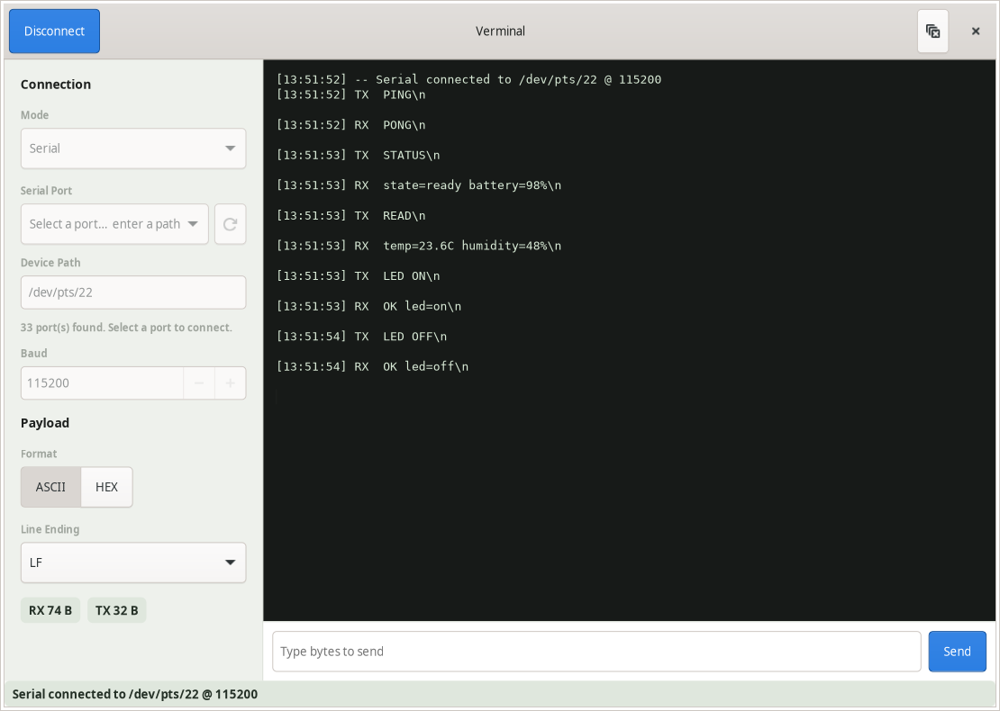
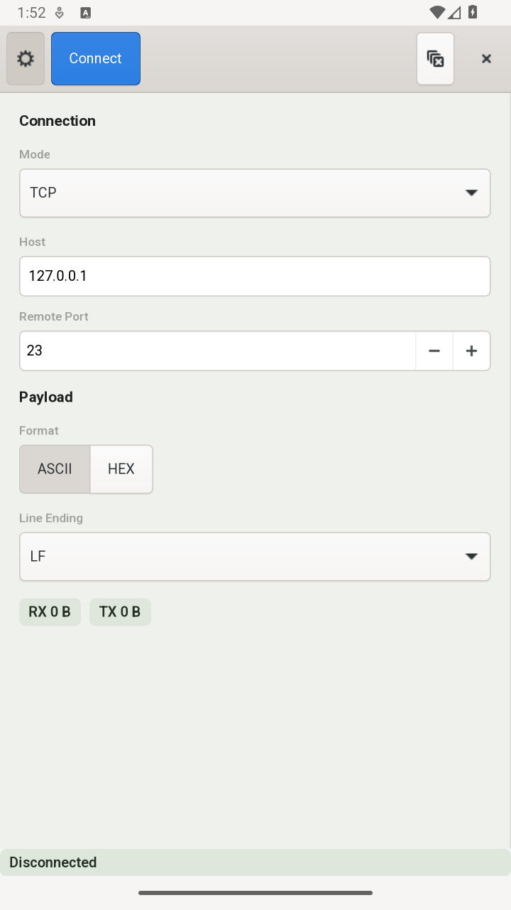

# Verminal

Verminal lets you talk to serial devices and TCP/UDP services from a computer,
phone, or tablet. Send text or hexadecimal bytes and see incoming and outgoing
data in one log.

- Find serial ports automatically, refresh the list, or enter a port yourself.
- Connect to TCP servers or send and receive UDP packets.
- Switch between ASCII text and HEX, with configurable line endings.
- Use USB serial adapters on Android through USB OTG.
- Work with a layout that adapts to phone, tablet, and desktop displays.

## Screenshots

| Desktop (Linux) | Android |
| :---: | :---: |
|  |  |
| Serial traffic with a simulated device. | Compact connection settings in the Android emulator. |

## Download and install

Get the app from the [latest release](https://github.com/supercamel/verminal/releases/latest)
and choose the file for your device:

| Device | Release file |
| --- | --- |
| Linux, Intel/AMD 64-bit | `Verminal-x86_64.AppImage` |
| Linux, ARM64 | `Verminal-aarch64.AppImage` |
| Windows, 64-bit | `Verminal-Setup.exe` |
| Android phones and tablets, ARM64 | `io.github.supercamel.Verminal-arm64-v8a-debug.apk` |
| Android x86_64 devices and emulators | `io.github.supercamel.Verminal-x86_64-debug.apk` |

**Linux:** make the AppImage executable, then open it. For example:

```sh
chmod +x Verminal-x86_64.AppImage
./Verminal-x86_64.AppImage
```

Use the `aarch64` filename on ARM64. Linux packages target Ubuntu 24.04 or a
compatible system.

**Windows:** run the installer and launch Verminal from the Start menu.

**Android:** requires Android 12 or newer. Open the APK on your device and allow
installation from your browser or file manager when Android prompts you.
Most phones and tablets use the ARM64 build.

Release packages include the application libraries. Building from source is
covered in the [developer section](#developers). macOS and iOS packages are not
currently available.

## Your first connection

On a small display, use the gear button to open connection and payload settings.
Tap it again to return to the log. Wider windows show settings beside the log.

1. Choose **Serial**, **TCP**, or **UDP**.
2. Set the connection details:
   - **Serial:** select a port and choose the baud rate your device expects.
   - **TCP:** enter the server's host and remote port.
   - **UDP:** enter the remote host and port, plus the local port to listen on.
     A local port of `0` lets the operating system choose one.
3. Press **Connect**.
4. Select **ASCII** or **HEX**, and the line ending your device expects:
   **None**, **LF**, **CR**, or **CRLF**.
5. Enter a payload and press **Send**. In HEX mode, `48 65 6C 6C 6F` sends the
   bytes for `Hello`.

Incoming and outgoing data appear in the log. Use **Clear** to empty the log or
**Disconnect** to close the connection.

### Connecting a serial adapter

After plugging in or unplugging an adapter, refresh the port list. Refresh keeps
your selected or manually entered port. You can also enter paths such as
`/dev/ttyUSB0` on Linux or `COM3` on Windows. Your Linux account needs permission
to open the serial device.

On Android, connect a supported adapter through USB OTG on a device with USB
host support. Refresh, select the adapter, and press **Connect**. Allow Android's
USB permission prompt. Refresh again if you unplug and reconnect the adapter.

### Help and feedback

[Report a problem or suggest a feature](https://github.com/supercamel/verminal/issues).
Include your operating system, Verminal version, connection type, and the error
shown in the status line. For serial problems, include the adapter model too.

## Developers

Verminal is written in Vala with GTK 4 and built with Meson. Its release packages
are produced by **sqgipkg**, using native dependencies supplied by **Ooblerg**.

### What are sqgipkg and Ooblerg?

**sqgipkg** is the build and packaging tool included with
[SQGI](https://github.com/supercamel/sqgi). SQGI provides a Squirrel runtime with
GObject Introspection support; its packager also supports compiled native apps
such as Verminal. sqgipkg reads [sqgipkg.json](sqgipkg.json), runs the native
builds, prepares platform dependencies, and bundles the results as Linux
AppImages, Windows installers, and Android APKs. The packager runs on SQGI;
Verminal's application code is compiled Vala/C.

Start with the [SQGI documentation](https://sqgi.readthedocs.io/en/latest/) and
[packaging tutorials](https://sqgi.readthedocs.io/en/latest/packaging/).
The repository also provides the current
[manifest reference](https://github.com/supercamel/sqgi/blob/master/tools/README.md)
and [Android setup and packaging guide](https://github.com/supercamel/sqgi/blob/master/docs/packaging/android.md).

**[Ooblerg](https://ooblerg.xyz/)** distributes prebuilt native libraries and
development tools for Windows, Linux, and Android. sqgipkg downloads packages
for the selected platform into private build environments, including the
headers, Vala bindings, and libraries needed to compile Verminal. Our manifest
selects Ooblerg's `gserial` package on desktop and `extras-gserial` on Android.
[GSerial](https://github.com/supercamel/gserial) is the library Verminal uses for
serial connections and device discovery.

See Ooblerg's [package catalogs](https://ooblerg.xyz/#packages) and
[getting-started instructions](https://ooblerg.xyz/#getting-started).
The Android SDK release used by this project is pinned in the manifest.

### Native application startup

Desktop packages launch a native executable. On Android, an Activity and
GTK/JNI launcher load `libverminal.so` and call the small
[sqgi_android_main adapter](src/android-entry.c), which starts the same Vala
application. Verminal's Android APK does not include the SQGI interpreter.
See SQGI's [native Android entry documentation](https://github.com/supercamel/sqgi/blob/master/docs/packaging/android.md#native-application-entry)
for the launcher interface.

### Build release packages

The [release workflow](.github/workflows/release.yml) records the tested SQGI
revision, Ubuntu 24.04 host dependencies, and Android toolchain setup. Use that
revision or a newer compatible sqgipkg installation when reproducing releases.
The workflow is also the reference for cross compilers and NSIS dependencies.

From a Verminal checkout:

```sh
sqgipkg setup --platform android --native-tools --accept-licenses
sqgipkg check --target all
sqgipkg build --target all --write-lock
```

To build an individual target:

```sh
sqgipkg build --platform linux --arch x86_64
sqgipkg build --platform linux --arch aarch64
sqgipkg build --platform windows
sqgipkg build --platform android --arch arm64-v8a
sqgipkg build --platform android --arch x86_64
```

Outputs go into `dist-linux-x86_64/`, `dist-linux-aarch64/`,
`dist-windows-x86_64/`, `dist-android-arm64-v8a/`, and `dist-android-x86_64/`.
Each target writes a `sqgipkg-build.json` receipt beside its output.
`sqgipkg.lock.json` records resolved build inputs; use `--locked` to replay them
with the recorded toolchain. Generated build files are excluded from Git.

Android APKs currently use debug signing for direct installation. Store
publication requires release signing; see the Android packaging guide above.
Pushing a `v*` tag runs the workflow and attaches packages to a GitHub release.

### Run in an Android emulator

```sh
sqgipkg setup --platform android --emulator --native-tools --accept-licenses
sqgipkg emulator --headless
sqgipkg deploy --platform android --arch x86_64 --serial emulator-5564
sqgipkg logs --platform android --arch x86_64 --serial emulator-5564 --logs-once
```

For a physical phone or tablet, use its device serial and the appropriate ABI,
usually `arm64-v8a`. The emulator supports UI and network testing; USB serial
transfers need a real device and adapter.

### Build and test locally on Linux

Install Meson, Ninja, Vala, GTK 4.10+ development files, and GSerial development
files with the device discovery API. Install Xvfb to run the UI tests headlessly.

```sh
meson setup build-dev -Dtests=true
meson compile -C build-dev
xvfb-run -a meson test -C build-dev --print-errorlogs
./build-dev/verminal
```

The integration tests exercise phone, landscape, tablet, and desktop layouts,
port selection and refresh, failed connections, and serial traffic through a
pseudo-terminal. They save layout screenshots in the build directory.
